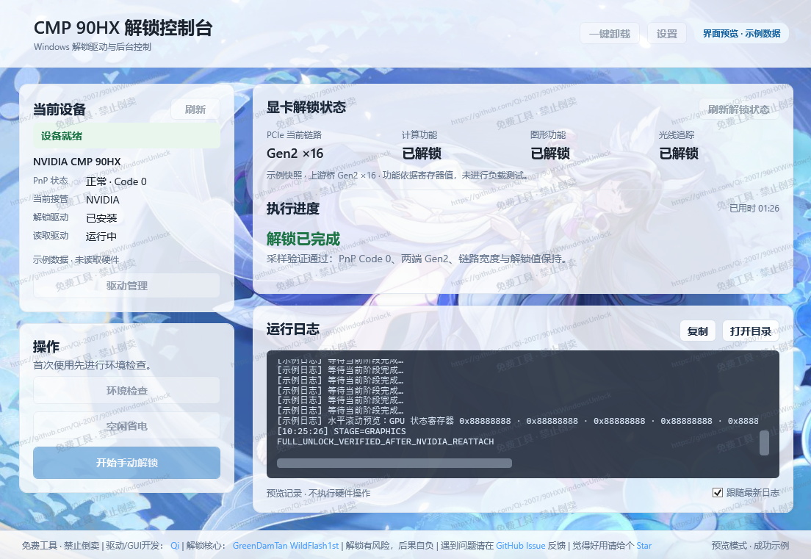

# CMP 90HX Windows Unlock

**简体中文** | [English](README.en.md)

**在 Windows 中管理 CMP 90HX 的解锁、状态读取与空闲省电。**

				[](LICENSE)

[下载](https://github.com/Qi-2007/90HXWindowsUnlock/releases) · [快速上手](#快速上手) · [常见问题](#常见问题) · [开发与构建](#开发与构建) · [问题反馈](https://github.com/Qi-2007/90HXWindowsUnlock/issues)

如果本项目为你提供了便利，请给我们一个 **Star**，为我的更新提供动力。

CMP 90HX Windows Unlock 为 NVIDIA CMP 90HX 提供 Windows 下解锁的图形控制台，集成 Native / Session 两种解锁方案、解锁状态读取和后台省电控制。前台负责交互，后台负责硬件操作；关闭窗口后，后台仍可按配置执行省电和唤醒任务。

本目录是独立的 **Console 项目**。Native、Session 后端分别构建，再以完整配套包接入控制台。

## 功能

|功能|说明|
|-|-|
| **双解锁方案** |在设置中选择 Native 或 Session，统一从控制台执行手动解锁。|
| **显卡解锁** | 无需通过EFI启动，在Windows系统下通过驱动程序解锁显卡功能和PCIe Gen2。 |
| **状态读取** | 查看 PCIe 链路、计算、图形和光追 override 状态。 |
| **驱动管理** | 安装、更新和卸载状态读取驱动及当前方案的解锁驱动，显示 NVIDIA 接管状态。 |
| **后台自动操作** | 可配置开机自启后台、开机自动解锁和睡眠唤醒后自动解锁。 |
| **空闲省电** | 空闲时限制到 P8，根据 GPU 负载、视频负载及应用例外恢复自动性能。 |
| **界面主题** | 自定义图片背景、各窗口和日志框透明度。 |
| **可选根证书功能** | 启用对应构建选项后，安装驱动前将检查根证书，缺失时自动安装随包证书。 |

> 各功能解锁状态仅表示源 override 寄存器达到目标值。实际可用性取决于配套 NVIDIA 驱动与初始化状态，请确保安装经过patch对应功能的特殊驱动程序。

## 截图


## 下载

发布入口：[GitHub Releases](https://github.com/Qi-2007/90HXWindowsUnlock/releases)。

使用前请下载并完整解压运行包。GitHub 的 Source code ZIP 是源码，不能作为已编译的软件直接运行。

>请保留运行包中的 `native`、`session`、`reader` 目录及 `files.sha256.json` 等配套文件。程序文件有哈希配对校验，缺失或修改可能无法运行。

## 快速上手

### 使用条件

* 支持 [.NET Framework 4.8.1](https://dotnet.microsoft.com/zh-cn/download/dotnet-framework/net481) 的 Windows 10 / 11 x64 系统。
* 当前仅针对 NVIDIA CMP 90HX（PCI ID `10DE:220D`）解锁，请提前安装好第三方修改后的 NVIDIA 驱动。
* 使用管理员权限运行控制台。

### 首次使用

1. 完整解压发布包，运行 `CMP90HXControl.exe`，允许管理员权限请求。
2. 点击 **环境检查**，确认当前系统的内核 DMA 保护状态。
3. 根据上一步提示，如果有需要请在右上角 **设置** 中切换到对应的解锁方案，再进入 **驱动管理**，安装读取驱动和所选方案的解锁驱动。
4. 点击 **开始手动解锁**，等待操作完成，查看执行日志和解锁后的验证结果。
5. 确认手动解锁成功后，可以按需配置 **空闲省电**、**开机自启后台** 和唤醒自动解锁等选项。

> 使用自定义根证书签名的版本会在安装驱动时自动补装缺失的随包根证书；证书安装失败会中止驱动安装。

### 如何选择解锁方案

|方案|工作方式|使用条件|
|-|-|-|
|**Native**|使用独立 worker 和 Native 驱动执行解锁事务。|要求内核 DMA 保护未开启；无需切换显卡驱动，解锁更快。|
|**Session**|使用session驱动临时接管显卡、执行解锁，确认 DMA 释放后恢复原 NVIDIA 驱动。|支持内核 DMA 保护。|

内核 DMA 保护开启时，控制台会禁止使用 Native 模式，请自行切换至 Session 模式。切换方案会卸载旧方案的解锁驱动，切换后仍需在驱动管理中手动安装新方案解锁驱动。

> 解锁期间显卡会暂时停用，可能导致部分程序出现闪退等异常行为。若提示 DMA 状态未确认或要求冷启动，应按提示恢复后再尝试。已加载驱动的更新或卸载也可能需要重启。

## 常见问题

### 为什么需要管理员权限？

驱动管理、设备启停和硬件访问需要管理员或 SYSTEM 权限。前台通过受保护的共享内存与后台通信，后台串行执行硬件操作。

### 为什么驱动安装失败？

请检查你下载的发布版本是否为自定义根证书签名版本，此版本无法在开启secureboot时载入，请在bios中关闭有关功能（**注意电脑是否已启用BitLocker，切换安全启动状态可能导致BitLocker失效、硬盘被锁死等严重问题，因此产生的一切后果请自行承担**）或使用第三方签名的版本（第三方可能向您收取费用，这与本人无关，请自行分辨、处理有关问题，不接受任何有关此类问题的反馈）。同时请检查内核dma保护状态，开启时native方案可能产生不可控的影响，因此程序会拒绝载入，请在bios中关闭有关选项或使用session方案。

### 关闭控制台后，省电和自动解锁还会继续吗？

后台保持运行时会继续按配置工作。关闭前台不会结束后台，也不会取消已提交的解锁任务。若希望重启系统后自动运行，需要在设置中启用 **开机自启后台**。

### 为什么状态没有实时刷新？

PCIe 与解锁寄存器状态通过 **刷新解锁状态** 手动采集，解锁完成后会再验证一次。读取失败时显示无法确认，不会使用旧快照代替当前结果。省电窗口的负载和功耗由后台单独采样。

### 为什么要安装自定义根证书？

自定义根证书可以伪造签名时间戳，以此使用过期的证书为驱动签名。在开启secure boot后，系统会拒绝加载此类驱动，因此使用此版本时需要在bios中关闭安全启动。如需开启安全启动解锁，请自行使用有效的证书签名sys并重新编译console，或者使用第三方签名的版本。

### 可以只复制 EXE，或者只换一个 SYS 吗？

请使用完整运行包。驱动包含对应 worker 的 SHA256 校验，控制台还会校验配套文件。更新、签名和重新打包的顺序见 [发布说明](docs/RELEASING_ZH.md)。

### 光追显示已解锁，为什么程序仍不支持？

当前状态来自 Quadro 源 override，实际功能还与 NVIDIA 驱动有关。请确认配套驱动支持，并通过实际光追工作负载检查正确性和性能。

## 开发与构建

## 如果你愿意加入我们，为扩大解锁内容、丰富程序功能做出贡献，请通过lll20001101@gmail.com联系我，我可以向你提供一些便利和资源。

Console 使用 WPF 与 .NET Framework 4.8.1。准备 Visual Studio MSBuild 和对应 Developer Pack；重编 Reader 或解锁驱动时，还需匹配的 Windows SDK / WDK。

先分别构建、签名 Native / Session 后端，将完整成品放入 `backends/native` 和 `backends/session`。Console 构建时缺少 Reader 会自动编译；已有时询问是否重编。重编后按提示签名 SYS，脚本验证后自动更新哈希，再编译前后台、生成运行包。`-NonInteractive` 可复用已有 Reader，`-RebuildReader` 可强制重编。

在本项目根目录运行：

```powershel
# 默认构建
.\\build.ps1

# 包含根证书管理及安装前自动补装功能
.\\build.ps1 -EnableRootCertificates

# 启动已构建的控制台
.\\build\\CMP90HXControl.exe
```

|文档|内容|
|-|-|
|[独立后端包](docs/backend-packages.md)|Native / Session 成品清单、文件配对与接入方式。|
|[发布步骤](docs/RELEASING_ZH.md)|Reader 签名、构建选项、哈希更新和发布打包。|
|[后台控制说明](docs/background-control.md)|自动解锁、开机任务、配置和日志。|
|[共享读取驱动](docs/shared-reader.md)|状态读取的职责、接口及验证方式。|

前台入口为 `CMP90HXControl.exe`，后台入口为 `CMP90HXBackground.exe`。配置位于 `C:\\ProgramData\\CMP90HX\\settings.json`。

## 致谢

* [GreenDamTan / RainCandyTech](https://github.com/GreenDamTan)：NVPermissive 核心及相关上游工作。
* [WildFlash1st / cmp90hx-unlock-for-windows](https://github.com/WildFlash1st/cmp90hx-unlock-for-windows)：Windows 解锁相关工作。
* [Qi](https://github.com/Qi-2007)：Windows 驱动、控制台与后台集成。

第三方输入及来源说明见 [THIRD\_PARTY\_NOTICES.md](THIRD_PARTY_NOTICES.md)。

## 许可证

本项目代码使用 [GNU GPL v3](LICENSE)，禁止二次闭源开发和一切商业行为。第三方核心、固件和驱动输入的来源及授权范围见 [第三方说明](THIRD_PARTY_NOTICES.md)。

## 问题反馈

欢迎提交 [GitHub Issue](https://github.com/Qi-2007/90HXWindowsUnlock/issues)。反馈时请附上：

* 控制台版本、Native / Session 方案及 NVIDIA 驱动版本。
* Windows 版本、内核 DMA 保护状态和设备问题代码。
* 操作步骤、完整错误信息，以及通过 **复制日志** 或 **打开目录** 取得的本次日志。

分享日志前请检查其中的本地路径和设备信息，移除不希望公开的内容。
